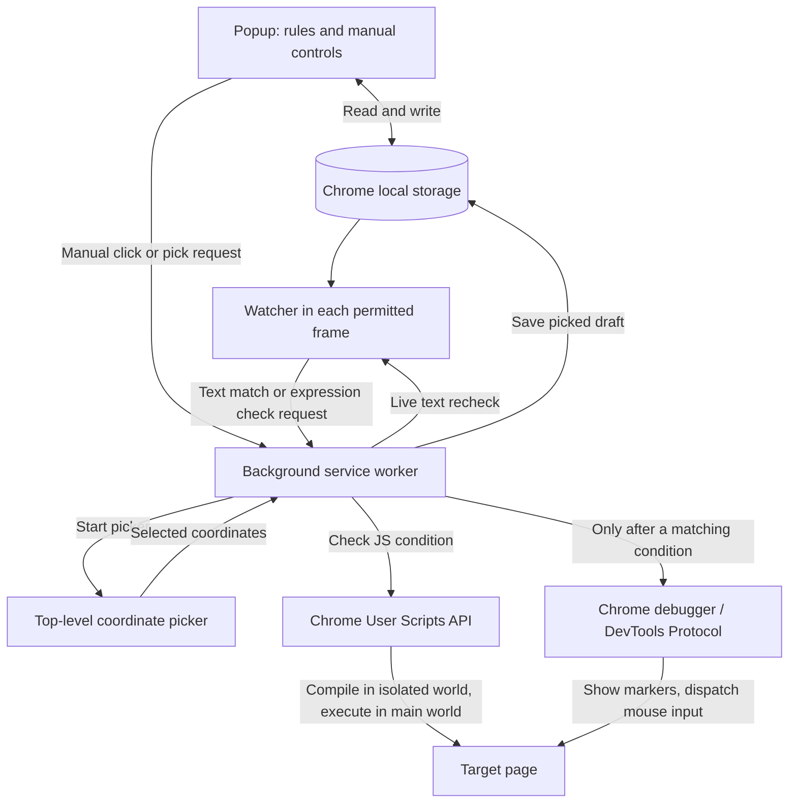

# Architecture

Clickyphus is a Chrome Manifest V3 extension. It runs manual coordinate clicks and automatic click grids when a page meets a saved condition. There is no backend: configuration stays in Chrome local storage, and execution happens inside the browser.

## Components

| Component                         | Responsibility                                                                                                         |
| --------------------------------- | ---------------------------------------------------------------------------------------------------------------------- |
| `extension/manifest.json`         | Registers the popup, background service worker, content scripts, and browser permissions.                              |
| `extension/popup/popup.html`      | Rule editor and manual click controls.                                                                                 |
| `extension/popup/popup.js`        | Loads and saves rules, validates input, starts manual clicks, and preserves drafts while picking coordinates.          |
| `extension/popup/popup-layout.js` | Presents each rule as an expandable row with a compact summary.                                                        |
| `extension/content/watcher.js`    | Watches page text in permitted frames and requests expression checks from the top-level frame.                         |
| `extension/content/picker.js`     | Displays a coordinate-selection overlay in the top-level page.                                                         |
| `extension/background.js`         | Coordinates messages, checks tab focus and rule conditions, serializes click jobs, and controls Chrome's debugger API. |
| `scripts/package.py`              | Packages the extension directory into a versioned ZIP.                                                                 |



## Popup editing

The popup shows only the selected condition type and preserves the other type's input when switching. JavaScript coordinate fields are labeled as fallbacks. Single-click patterns hide the unused grid controls. A shared sticky save bar applies the complete rule list, with an unsaved-state indicator, inline validation, and undo for the most recent removal before saving. Removal is staged in the editor until saved. The `[hidden]` CSS rule explicitly takes precedence over component display styles.

## Automatic rules

Every rule includes an enabled flag, URL substring, condition, viewport coordinates, grid size, spacing, click delay, and marker preference. URL matching is case insensitive and uses the top-level tab URL. A blank URL filter (including whitespace) or `*` matches all supported pages; other values are literal substrings, not wildcard patterns. Rules without a `ruleType` retain the original text behavior.

### Page text

The watcher loads saved rules into each permitted frame. It scans DOM text, including open shadow roots, while excluding script, style, noscript, and template content. Text matching is case insensitive and does not require the text to be visible.

Checks start once the DOM is ready, without waiting for images or other resources. Startup checks run after 450 ms, 1 second, and 2 seconds; false JS results remain eligible for retry. DOM changes and the window load event schedule a scan after 450 ms, and a timer continues scanning every 2.5 seconds. A matching phrase produces an `AUTO_TEXT_FOUND` message; the worker checks the saved rule, URL, and tab focus before scheduling clicks. The watcher coalesces in-flight notifications but retries matching text on subsequent scans; a skipped or failed first notification does not permanently suppress it. The worker prevents duplicate successful sweeps. Navigation completion and URL changes request fresh checks, and restored pages restart their early checks. Failures before any mouse press leave rules eligible for retry.

Before each automatic click, the worker asks the originating document or frame whether the phrase is still present. Navigation, a missing frame, a failed recheck, or disappearing text stops the sequence.

### JavaScript expression

When expression rules are enabled, the top-level watcher sends `CHECK_EXPRESSION_RULES` during scans. The worker selects enabled rules matching the URL and evaluates their expressions through `chrome.userScripts.execute`, bound to the originating top-level document ID. A preflight condition check runs before debugger attachment; false results and errors do not open a debugger session.

The source is compiled without executing it in a named `USER_SCRIPT` world with eval enabled and extension messaging disabled. Compilation tries an expression first, then a function body. Its function source is cached by rule code, with a maximum of 100 entries. The worker injects that function directly in `MAIN`, outside the result-normalization function's scope so page globals are not shadowed. This supports the page's DOM and JavaScript globals without using `eval` or `new Function` in the main world, including on pages with strict CSP and Trusted Types.

Chrome 138+ and the `userScripts` permission are required. The user enables **Allow User Scripts** in Chrome's extension settings. The popup queries availability through `GET_USER_SCRIPTS_STATUS` and shows setup instructions when JS rules need it. If access is missing or revoked, JS rules pause; there is no debugger fallback. Text rules and manual clicks do not depend on this permission.

Expressions run in the top-level page context, with access to its DOM and JavaScript globals. They synchronously return `true` for saved coordinates, `{ x, y }` for a computed grid center, or `false` to skip clicks. Uppercase `{ X, Y }` is also accepted. Coordinates must be finite nonnegative numbers. Expressions and function bodies with `return` are supported; other results, promises, and errors do not trigger clicks. User Scripts has no execution-timeout option; code should remain short and synchronous. The previous debugger-based 500 ms timeout no longer applies. For example:

```js
return document.querySelector('button.ready') !== null;
```

After a successful preflight, the condition and center are checked again after debugger attachment, since the Chrome banner can change the viewport layout. The grid center is then fixed for that sweep. The same expression is checked before every click, and again after showing a marker. A false result or error stops the sequence. Expressions should have no side effects because evaluation repeats. Expression checks are skipped while the tab already has a queued click job.

### Repeat prevention and focus

The worker tracks fired rule IDs per tab in memory. A rule normally runs once per top-level page load; loading or URL changes clear that tab's fired set. A stopped run that completed zero clicks can be retried. Closing the tab removes its tracking state.

Clicks require the target tab to be active in a focused window, and coordinate picking temporarily prevents click execution in that tab. Activating a tab or focusing a window requests fresh watcher checks.

The fired set and job queues are service-worker memory, rather than durable storage. Restarting the worker resets them, so the once-per-load tracking does not survive a worker restart.

## Click execution

Manual requests and automatic rules share `clickGrid`. Jobs run serially within each tab. Manual requests are acknowledged immediately, then wait 600 ms to let the popup close before execution.

The manual test panel sends its own X / Y fields; it does not evaluate automatic rules. For automatic expression rules, the worker resolves the returned coordinates before generating the grid and logs the resolved center. A `true` result uses saved rule coordinates, while a valid coordinate object overrides both axes.

The worker validates the click settings, builds a square grid around the requested point, rounds coordinates to CSS pixels, and skips negative coordinates. Points are sorted by distance from the requested center. A grid size of one produces a single click.

For each point, the worker checks focus and any automatic condition, optionally draws a marker, and sends mouse move, press, and release commands using `Input.dispatchMouseEvent`. This sends browser input rather than calling an element's DOM `click()` method. Coordinates are relative to the top-level viewport, allowing clicks over nested frames without resolving a target element.

The debugger is detached in a `finally` block after an attached job finishes or fails. Manual jobs have no rule-condition guard, but still stop when the target loses focus.

## Coordinate picking and popup lifetime

The popup is short lived and closes when the user starts picking on the page. Before closing, it saves the current manual setup or unsaved rule fields and the intended picker target.

The worker asks the top-level picker to show a modal overlay. The overlay captures the selection without activating the underlying page control and returns rounded `clientX` / `clientY` coordinates. Escape, page hiding, or a 60-second timeout cancels picking.

The worker verifies the tab and draft target, updates the matching draft, and attempts to reopen the popup. If reopening fails, the saved draft is restored on the next popup open. Picking a rule position does not activate its unsaved edits; the user still saves the rules.

## State and browser boundaries

| State                                       | Location              | Purpose                                                                                                      |
| ------------------------------------------- | --------------------- | ------------------------------------------------------------------------------------------------------------ |
| `autoRules`                                 | Chrome local storage  | Saved rule configuration shared by popup, watcher, and worker.                                               |
| `autoRule`                                  | Chrome local storage  | Legacy single-rule data read by the popup and watcher.                                                       |
| `lastSweep`                                 | Chrome local storage  | Last execution source, rule ID, resolved center, first click, version, and start time for popup diagnostics. |
| `manualDraft`, `rulesDraft`, `pickerTarget` | Chrome local storage  | Preserve editing and selection state across popup closure.                                                   |
| Job queues, fired rule IDs, picking tabs    | Worker memory         | Coordinate execution and prevent repeated work during the worker's lifetime.                                 |
| Loaded rules and reported phrases           | Content-script memory | Scan each frame and suppress duplicate text notifications.                                                   |

Content scripts run in Chrome's isolated extension context. User expressions are compiled in an isolated user-script world and run in the page context through the User Scripts API; the popup does not evaluate them. Text notifications carry the matching phrase rather than the page's full text.

The manifest grants debugger, tab, active-tab, storage, userScripts, and all-URL host access. Chrome-restricted pages cannot use the content scripts or picker, and debugger attachment failures abort jobs. The extension does not make application-level network requests or use a remote service.

## Development and packaging

Load `extension/` as an unpacked extension. After code changes, reload the extension and refresh open pages to replace their content scripts.

`npm test` runs unit and regression tests. `npm run test:browser` runs the isolated Chrome integration test for User Scripts, strict page policies, permission changes, and debugger attachment. `npm run check` runs ESLint and Prettier checks. `npm run build` invokes the Python packaging script, which reads the manifest version and writes `dist/clickyphus-<version>.zip`. The archive contains extension files only; repository documentation and development dependencies are excluded.
