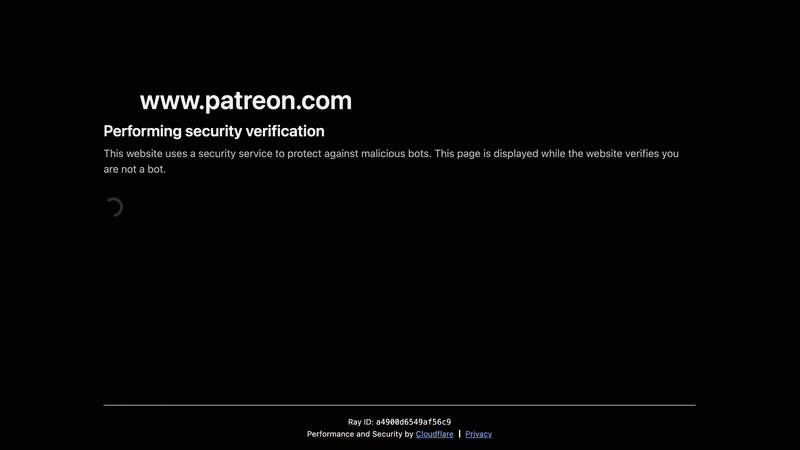
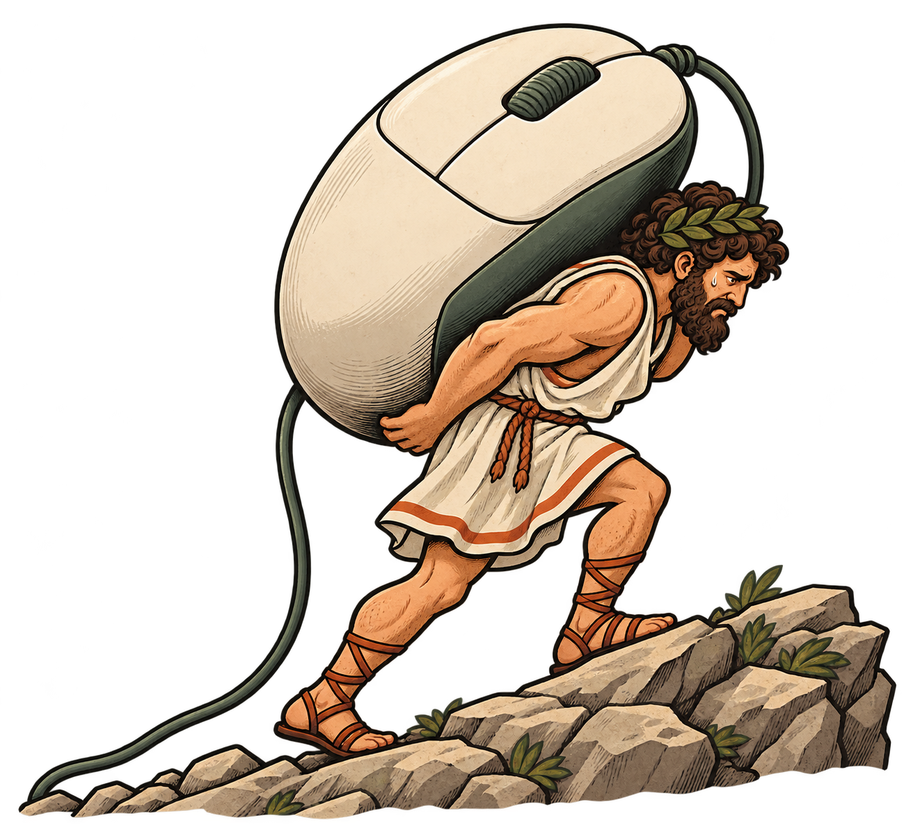

# Clickyphus

## Demo 


## The Greeks understood existential dread, and this extension does as well


## Installation

```
1. git clone https://github.com/blowhacker/clickyphus.git
2. goto chrome://extensions/
    - enable developer mode
    - load unpacked from extensions dir
```

See [ARCHITECTURE.md](ARCHITECTURE.md) for the components, rule evaluation, click execution, and storage flows.

## Development

Tested on Chrome 138. Load `extension/` via **chrome://extensions → Developer mode → Load unpacked**.
After changes, reload the extension and refresh open pages.

```sh
npm ci
npm test        # Rule evaluation and click-coordinate regression checks
npm run check   # Lint and check formatting
npm run format  # Apply formatting
```

## Packaging

```sh
npm run build
```

Creates `dist/clickyphus-<version>.zip` with only extension files.
Packaging can also run directly with `python3 scripts/package.py`, without npm.

## JavaScript expression rules

After reloading the updated extension, go to **chrome://extensions → Clickyphus → Details → Allow User Scripts** and turn it on. The popup offers an **Open extension settings** button when this is needed. If the setup message remains after reopening the popup, reload the extension and refresh the target page.

JS conditions are checked through Chrome's User Scripts API, without attaching the debugger. False results, errors, and missing permission do not show the debugging bar. Chrome's bar appears when a matching rule starts a click sequence. There is no fallback to debugger-based condition evaluation. Page DOM access, page globals, `console.log`, expressions, and blocks with `return` still work.

Choose **JavaScript expression** as the rule type, optionally enter a URL match and enter an expression such as `document.querySelector('button.ready') !== null`, then save. Expressions run in the top-level page and can access `document`, `window`, and page variables. Return `true` to use saved coordinates, `{ x, y }` to override the grid center, or `false` to skip clicks. Coordinates must be finite nonnegative numbers; uppercase `{ X, Y }` is also accepted. Expressions and function bodies with `return` are supported. Invalid results, promises, and errors prevent clicks. Use condition expressions without side effects because they are evaluated repeatedly (after DOM readiness with early retries at 1 and 2 seconds, then about every 2.5 seconds, on page mutations and focus, and before each click). Checks do not wait for slow images to load. Return `false` while the element or app state you need is not ready; checks continue until the rule matches. As with text rules, only the focused active tab runs, once per page load.

Leave **URL contains** blank, or enter `*`, to match all supported pages. Other values match a case-insensitive URL substring; wildcard patterns such as `*.example.com` are not supported.

For a computed position, you can also use code with `return`:

```js
const button = document.querySelector('button.ready');
if (!button) return false;
const rect = button.getBoundingClientRect();
return { x: rect.left + rect.width / 2, y: rect.top + rect.height / 2 };
```

The returned coordinates set the grid center at the start of the sweep. Grid size, spacing, and delay still use the rule settings. The condition is rechecked before clicks, but later coordinate results do not move the grid mid-sweep.

To use computed coordinates, save the automatic rule and let it trigger on the focused page. The manual **Run manual click** button uses the manual X / Y fields and does not evaluate automatic rules. The popup's expandable **Last click** section shows the execution source (JS rule, text rule, or manual), resolved grid center, first click position, and version that executed it. The current loaded version also appears in the footer. The background worker's `resolved sweep center` log shows the actual center selected after evaluating a rule.

For grid size **1 × 1**, spacing and delay are disabled and ignored. Larger grids require valid spacing and delay values.

Grid delay accepts whole numbers from 0 to 5000 ms, including 30 ms. This pause is added after releasing the mouse button; each click also includes an 80 ms button hold, and visual markers add time when enabled.

## Editing rules

Only the selected rule type's condition fields are shown. Switching between page text and JavaScript keeps both inputs, and JS rules label saved coordinates as fallback values. New rules start with a single click; select a larger pattern to reveal spacing and pause controls. Grid sizes from 1 to 20 are available.

Use the shared **Save changes** button to apply edits, enable/disable changes, and removals. The footer tracks unsaved changes, and validation points to the affected field. Removing a rule can be undone before saving. Ordinary unsaved edits are discarded when the popup closes; coordinate picking preserves a draft so editing can continue afterward.

## Browser regression test

```sh
npx playwright install chromium
npm run test:browser
```

This launches an isolated test profile, exercises the Allow User Scripts toggle, verifies false checks never attach the debugger, and tests matching DOM/page-global conditions under strict CSP and Trusted Types. It also checks permission revocation and text-rule behavior. Set `CHROMIUM_EXECUTABLE` to reuse an existing Chrome for Testing installation.

## Development copy

This project lives at `~/work/clickyphus`. The original `~/work/coordinate-click-companion` project remains separate. Load this copy’s `extension/` directory in Chrome to use Clickyphus. It has its own saved rules and permissions; enable Allow User Scripts for this copy if you use JavaScript rules.

## First-install rules

`extension/default-rules.js` defines the rules shipped with Clickyphus. It contains a plain `const RULES = [...]` array; you can also append with `RULES.push(...)`. The worker copies serializable settings into local storage once on fresh installation. Built-in JavaScript conditions execute as packaged extension code through `chrome.scripting`; they do not require Allow User Scripts. They appear in the popup editor with enable/disable and URL/click settings. Their condition code stays in the file. Custom JavaScript expressions entered in the popup still require Allow User Scripts.

Add the real rules you want to ship to `RULES`, normally with `enabled: true`. A commented template in `default-rules.js` shows how to add another rule. Updates and reloads preserve existing rules, edits, and intentionally empty rule lists. After editing config, run `npm run build` (or `npm run prepare:rules`) and reload the extension. Changing a bundled condition changes its behavior on the next check after that reload; changing its default settings affects future installs. Keep each rule ID stable.

See [the rule specification](docs/RULES.md) for fields and a complete example.
